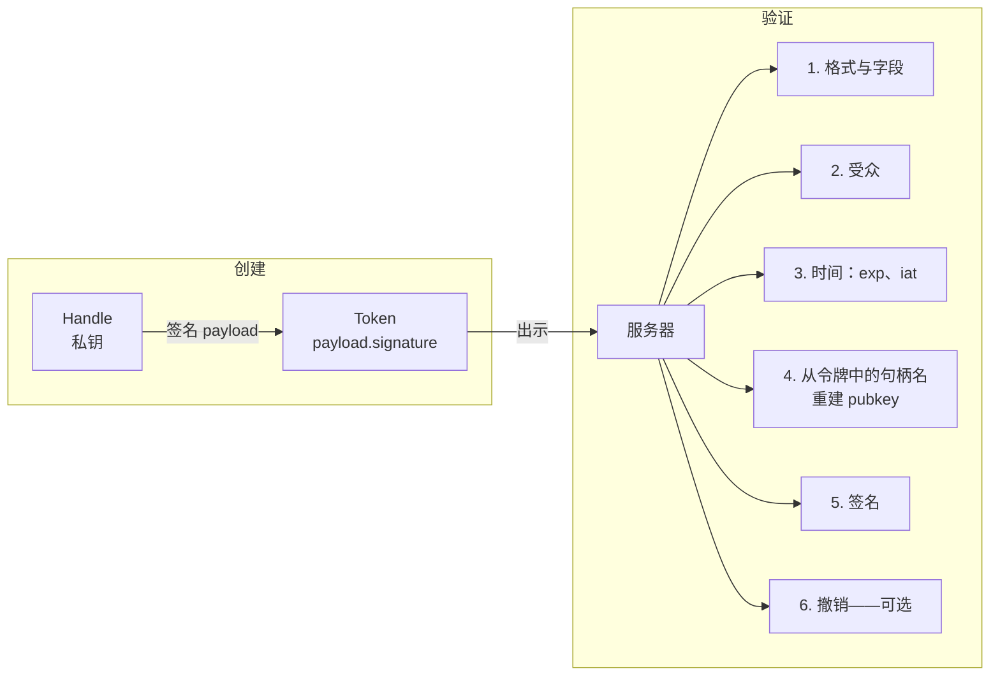
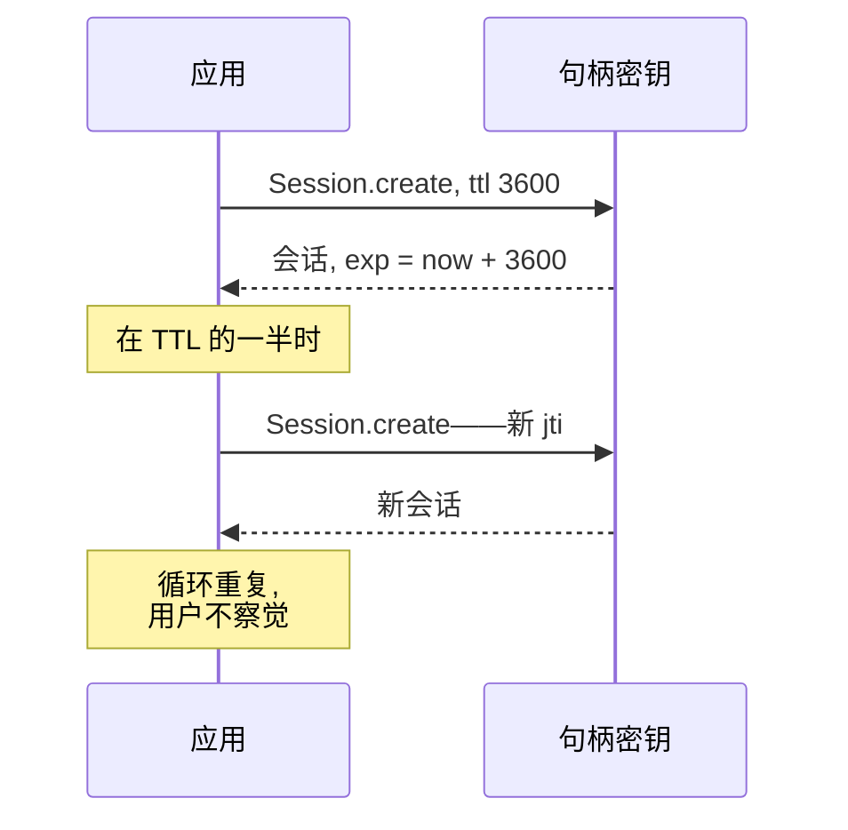

每个经典授权系统都存储会话。用户登录——服务器在 Redis 或 PostgreSQL 中创建一条记录：*用户 X 已登录，权限是这样那样，到期时间是那样那样*。每个后续请求都去那个存储里查校验。存储成了单点故障、扩展目标和攻击靶子。

Me2eM 的工作方式不同：会话是一个**自包含的已签名令牌**。服务器校验签名并从令牌中读取数据——无需一次存储查询。与 JWT 相同的原理，但密码学基础和信任模型不同。

## 令牌里面有什么

会话由句柄创建——用句柄的密钥签名：

```typescript
import { Session } from '@me2em/core';

const session = await Session.create(connector, {
  audience: 'ev-app.com',       // 这个令牌给谁
  scopes: ['charge:start'],     // 能做什么
  ttl: 1800,                    // 多少秒
});
```

被签名的 payload：

```typescript
interface SessionPayload {
  hId: string;        // 谁：句柄公钥的 base64url
  hNm: string;        // 句柄名（规范名）
  hPath?: string[];   // SubHandle 的派生路径：['station-001', 'connector-ccs']
  aud: string;        // 受众
  scp: string[];      // 权限
  exp: number;        // 何时过期
  iat: number;        // 何时签发
  jti: string;        // 唯一 ID——撤销的钥匙
}
```

令牌：`base64url(payload).base64url(Ed25519 签名)`。授权所需的一切——都在已签名信封里。



## 服务器如何一步步检查

验证器没有签名者的密钥。它**从令牌中的名字重新计算**公钥——这得益于确定性派生：

```typescript
// 验证器持有 Identity——从名字重新计算句柄密钥
const handle = await identity.deriveHandle(payload.hNm);
// 或对于 SubHandle——按完整路径：
const sub = await identity.deriveSubHandle(payload.hPath[0], payload.hPath[1]);
```

检查序列：

| # | 检查项 | 拒绝什么 |
|---|--------|----------|
| 1 | 格式：两个 base64url 部分，大小 ≤ 4096 字节 | 损坏的令牌 |
| 2 | 必填字段：hId、hNm、aud、scp、exp、iat、jti | 不完整的令牌 |
| 3 | 受众：`aud` 与预期值匹配 | 另一个服务的令牌 |
| 4 | 时间：`exp` 未过期，`iat` 不在未来（偏差 ±30 秒） | 已过期和伪造的"来自未来" |
| 5 | 重建公钥 + 签名校验 | payload 伪造 |
| 6 | `hId` 与重新计算的 pubkey 匹配 | 身份替换 |
| 7 | 撤销：`jti` 不在已撤销列表中 | 强制撤销的会话 |

全部七项通过后——会话才被视为有效。服务器从未触碰数据库。

## 撤销：唯一的状态点

Stateless 不代表"无法撤销"。它意味着——**撤销是可选且可分层的**。

```typescript
interface RevocationChecker {
  isRevoked(jti: string): Promise<boolean>;
}
```

想要即时撤销会话（不等 TTL 到期）的服务器实现这个接口——例如基于 Redis SET：

```typescript
// 撤销单个会话（jti——来自被撤销令牌的已签名 payload）：
await redis.sadd('me2em:revoked', jti);

// 检查——O(1)，每层约 0.1 毫秒：
const revoked = await redis.sismember('me2em:revoked', jti);
```

代价是诚实的：没有撤销存储就没有即时撤销（会话活到 TTL）。有存储——即时撤销存在，但出现了状态（小的，但仍是状态）。Me2eM 给出选择：纯 stateless 或即时撤销——由应用决定。

## 与 JWT 的区别

相似是表面的：两者都是带 payload 的已签名令牌。区别在于信任模型和签名基础：

| 方面 | JWT | Me2eM 会话 |
|--------|-----|-------------|
| **签名基础** | 服务器密钥（HMAC）或服务器私钥 | 句柄密钥——从用户 seed 确定性派生 |
| **谁创建** | 服务器 | **客户端**——句柄自己签名 |
| **令牌中的身份** | `sub`——DB 中的字符串 | `hId`——句柄的公钥，可密码学校验 |
| **层级** | 无 | `hPath`——派生树路径 |
| **分支撤销** | 无 | 证明 `jti` 禁用整条分支（Mode 2 下） |
| **无 DB 验证** | 是，但需要服务器密钥 | 是，且**服务器甚至不需要密钥**——只需公钥根 |

关键区别在于**谁拥有签名密钥**。JWT 中服务器签名，所以服务器全能：它可以签发任何权限的任何令牌。Me2eM 中用户的句柄签名——服务器只**验证**，无权创建他人的会话。这是信任的转移：从"相信服务器"到"验证密码学"。

关于表格的一个澄清。上面描述的所有内容都是 Mode 1（`verifyStateless`）：验证器持有 `Identity` 并自己从令牌中的名字重新计算密钥。"服务器甚至不需要密钥"这一行指的是 Mode 2（`verifyAttested`）：服务器对照**公共**根密钥验证父级证明链，并在每次检查中强制执行授予。完整拆解——见[关于证明链的文章](/zh/blog/attestation-chains-delegated-trust)。

## 自动续期：无需登录的会话

令牌是短寿命的（≤ 1 小时——建议）。但不能要求用户每小时登录一次。解决方案是自动续期：



在 `@me2em/react` 中这内置于 `useSession`：在 TTL 一半时自动续期，unmount 时清理计时器，每次续期时轮换 `jti`。用户数周无需输入 seed——会话自动更新，每个令牌的 TTL 保持短。

## 总结

| 属性 | 如何实现 |
|----------|----------|
| 验证无需 DB | 所有数据在已签名 payload 中 |
| 无需服务器密钥验证 | 从名字重建 pubkey（确定性） |
| 即时撤销 | `jti` + `RevocationChecker`——可选 |
| 短 TTL 无 UX 成本 | TTL 一半时自动续期 |
| 令牌中的层级 | `hPath`——派生树路径 |
| 整条分支撤销 | 证明 `jti`（Mode 2） |

Stateless 会话不是 Me2eM 的发明：这是一个与 PGP 一样古老的想法。但将 stateless 令牌与确定性派生和证明链连接起来，给出了经典方案不具备的属性：**一个在数据库中零记录的服务器——在 Mode 2 下甚至无需一个密钥——验证的不仅是"你是谁"，还有"谁允许你存在"**。

## 接下来阅读

- **[即时撤销：stateless 世界里的撤销](/zh/blog/revocation-checker-instant-revocation)** —— jti 撤销如何运作：粒度、fail-open/closed、记录 TTL
- **[证明链：无服务器的信任委托](/zh/blog/attestation-chains-delegated-trust)** —— Mode 2：委托与分支撤销
- **[Me2eM：来自种子短语的身份](/zh/blog/me2em-seed-derived-identity)** —— 基础篇：句柄密钥从何处来
- **[@me2em/core 在 npm 上](https://www.npmjs.com/package/@me2em/core)** —— 实现
