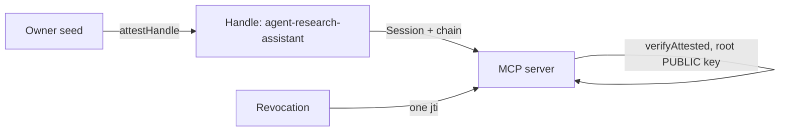

## What you can build

A workforce of autonomous agents that are safe to let out of your
infrastructure: each agent holds its own Ed25519 keypair — not your API key —
bound by a parent-signed mandate that states whose agent it is, what it may
do, for which audiences, until when. An MCP server, a tool provider, or a
peer agent verifies the mandate with the owner's public key alone.

## How it works

The owner derives a Handle per agent and attests it. The attestation chain
carries the mandate: scopes, audiences, TTL caps — enforced at verification
time, not at issuance.



```typescript
const A = await ownerIdentity.attestHandle('agent-research-assistant', {
  audiences: ['mcp.example.com', 'tools.example.com'],
  scopes: ['search:web', 'files:read'],
  maxSessionTtl: 3600,
});
// Ship agentHandle + A.token to the agent runtime.
```

The agent signs sessions itself — no owner key ever sits inside the agent's
runtime. For known services it derives channel keys via
`deriveSharedSecret`; for offline peers it publishes a `PreKeyBundle`.

## Benefits

- **No shared API keys.** A leaked agent key exposes one agent, not the owner.
- **One-call revocation.** `revokeAttestation(A.jti)` disables the agent
  everywhere — current and future sessions, every audience.
- **Mandates cannot be forged wider.** Nobody — including the agent — can
  extend its own scopes.
- **Offline verification.** Any third party checks the chain with the root
  public key; no database, no network.

## Trade-offs

- **The owner's seed is the root of trust.** Its loss or compromise
  compromises every attested agent.
- **A revocation store must be consulted.** Revocation is only instant for
  verifiers that check `jti`.
- **Alpha.** Package APIs are pre-1.0; pin versions.

## References

- Scenario 1 in the [protocol Use Cases guide](https://github.com/me2em-org/me2em-protocol/blob/main/packages/core/USE_CASES.md#scenario-1-ai-agent-delegation-uc-1)
- API reference at [core.me2em.com](https://core.me2em.com)
