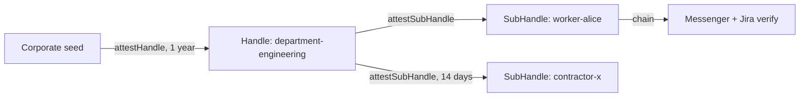

## What you can build

A corporate identity layer where the machine that issues access never holds
the master key: HR attests employees and contractors under the department's
grant, the messenger and Jira verify the same chains independently, and
termination is one revocation effective everywhere.

## How it works

The corporation attests each department once; the HR machine derives and
attests workers under that grant. Scope ceilings are inherited — even a
compromised HR machine cannot create an employee with rights above the
department's.



```typescript
const worker = await deptHandle.deriveSubHandle(employeeId, {
  allowedAudiences: ['corp-messenger.internal', 'jira.internal'],
  allowedScopes: scopes,
  maxSessionTtl: 28800, // one workday
});
const B = await deptHandle.attestSubHandle(employeeId, {
  audiences: ['corp-messenger.internal', 'jira.internal'],
  scopes, maxSessionTtl: 28800,
}, { ttlSeconds: 365 * 24 * 3600 });
```

## Benefits

- **Split knowledge.** The root key lives in a vault; HR operates on
  attested grants alone.
- **No escalation path.** `channel:management` outside the department grant
  is rejected by every verifier — `SCOPE_EXCEEDED` at level `ROOT`.
- **One-operation offboarding.** `revokeAttestation(B.jti)` kills all current
  and future sessions of the worker in every connected service.
- **Contractors expire themselves.** A two-week TTL needs no offboarding
  action on the end date.

## Trade-offs

- **Department grant is a ceiling.** Privileges above it require a separate
  handle attested by the root directly.
- **Mode 1 has no branch revocation.** If internal tools verify
  `verifyStateless`, only per-session `jti` is revocable — use Mode 2 where
  offboarding matters.
- **Alpha.** Package APIs are pre-1.0; pin versions.

## References

- Scenario 7 in the [protocol Use Cases guide](https://github.com/me2em-org/me2em-protocol/blob/main/packages/core/USE_CASES.md#scenario-7-corporate-messenger-uc-3-multi-context-identity)
- A production Redis [RevocationChecker](https://github.com/me2em-org/me2em-protocol/blob/main/packages/core/USE_CASES.md#%EF%B8%8F-infrastructure-production-revocationchecker-redis) implementation
