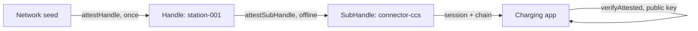

## What you can build

A charging network whose stations never need a network to work: provisioning
once at install, connectors derived and attested on the device, sessions
signed onboard, and an independent charging app authorizing each session with
the operator's public key alone. The same pattern covers a guest token in a
smart home — 24 hours, gate only, cameras outside the grant.

## How it works

Each station is a Handle attested by the network owner. The station derives a
SubHandle per connector and attests it locally; sessions are created by the
SubHandle and verified by the app as an external organization.



```typescript
class ChargingStation {
  async addConnector(connectorId: string, type: string) {
    const connector = await this.stationHandle.deriveSubHandle(connectorId, {
      allowedAudiences: ['ev-charging-app.com'],
      allowedScopes: ['charge:start', 'charge:stop', 'charge:status'],
      maxSessionTtl: 7200,
      displayName: `${type} Connector`,
    });
    const B = await this.stationHandle.attestSubHandle(connectorId, {
      audiences: ['ev-charging-app.com'],
      scopes: ['charge:start', 'charge:stop', 'charge:status'],
      maxSessionTtl: 7200,
    }, { ttlSeconds: 365 * 24 * 3600 });
    return { connector, B };
  }
}
```

## Benefits

- **Zero-connectivity operation.** Adding a connector takes two local
  operations: derivation plus a self-issued attestation.
- **Contained compromise.** A broken-in station can only attest its own
  connector names, only `charge:*` scopes, only sessions under the grant —
  the network stays safe.
- **Independent verifiers.** The charging app never holds the operator's
  private root — Mode 2 verification with the public key.
- **One flag per station.** Retiring or suspecting a station is a single
  revocation honored by every verifier.

## Trade-offs

- **Mode 1 for internal telemetry only.** The operator's own fleet service
  holds the root — harden that perimeter.
- **Grant refresh cycle.** Station attestations carry a trust window (e.g.
  one year) — plan re-attestation visits or OTA refresh.
- **Alpha.** Package APIs are pre-1.0; pin versions.

## References

- Scenario 6 in the [protocol Use Cases guide](https://github.com/me2em-org/me2em-protocol/blob/main/packages/core/USE_CASES.md#scenario-6-ev-charging-network-uc-2--iot-device-hierarchy)
- API reference at [core.me2em.com](https://core.me2em.com)
