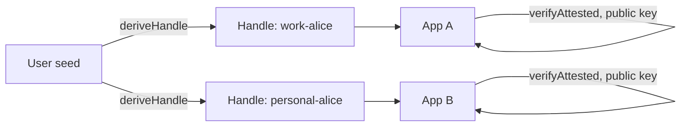

## What you can build

A single identity that opens every application in your ecosystem — without a
user database. The account is a seed phrase: one root, many contexts. Each
application sees only the Handle the user chooses to present, and verifies
the session with the root public key alone.

## How it works

The user derives a Handle per context — work, personal, devices — and
presents the appropriate one to each application. The application verifies
the session chain with the operator's public key.



```typescript
const workHandle = await identity.deriveHandle('work');
const session = await workHandle.createSession({
  audiences: ['app-a.internal'],
  scopes: ['profile:read', 'projects:write'],
  maxSessionTtl: 28800,
});
```

## Benefits

- **No user database.** No credentials to store, no breach surface, no
  compliance burden.
- **Stateless verification.** Each application verifies with the public key
  alone — no session store, no token introspection.
- **Correlation-resistant.** Each Handle is a separate keypair; applications
  cannot link the user across contexts without her consent.
- **One revocation to sign out.** `revokeAttestation(root.jti)` signs the
  user out of every application simultaneously.

## Trade-offs

- **The seed is the single point of failure.** Lose the phrase — lose every
  identity. There is no password reset by design.
- **Revocation requires a store.** Instant revocation is only available to
  verifiers that check `jti`.
- **Alpha.** Package APIs are pre-1.0; pin versions.

## References

- Scenario 4 in the [protocol Use Cases guide](https://github.com/me2em-org/me2em-protocol/blob/main/packages/core/USE_CASES.md#scenario-4-multi-app-sso-uc-4)
- API reference at [core.me2em.com](https://core.me2em.com)
