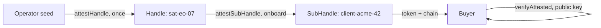

## What you can build

A marketplace for spacecraft resources: buyers purchase imaging *tasking /
direct-access* windows, transponder time, or downlink capacity — and receive
a signed, time-boxed, scope-boxed receipt instead of a credential. The
spacecraft issues the sale itself, offline, between ground contacts.

## How it works

Each spacecraft is a Handle attested by the operator. Onboard, the craft
derives a SubHandle for the buyer, attests it with the sold window's grant,
and issues the session — the token plus the chain is the product.



```typescript
const B = await satHandle.attestSubHandle('client-acme-42', {
  audiences: ['tasking.portal.example'],
  scopes: ['imaging:task', 'imaging:fetch'],
  maxSessionTtl: 1800,
}, { ttlSeconds: 1800 }); // the attestation dies with the window
```

## Benefits

- **No root keys in the deal.** The buyer never receives a private key —
  the signed receipt *is* the purchasable artifact.
- **Offline settlement.** The spacecraft attests the sale onboard; ground
  contacts are not needed for the deal to exist.
- **Tamper-proof terms.** Purchased scope and duration are signed statements
  the buyer cannot extend — renewal is a new sale.
- **Instant kill-switch.** A window is cancelled by revoking `B.jti` — e.g.
  the spacecraft enters safe mode.

## Trade-offs

- **Sales planning must respect contacts.** The attestation is issued
  onboard: pre-provision before a pass or deliver at the next contact.
- **The operator's seed is the root of trust.** Its compromise compromises
  every spacecraft.
- **Alpha.** Package APIs are pre-1.0; pin versions.

## References

- Scenario 2 in the [protocol Use Cases guide](https://github.com/me2em-org/me2em-protocol/blob/main/packages/core/USE_CASES.md#scenario-2-satellite-capacity-marketplace-uc-2--selling-access-mode-2-flagship)
- API reference at [core.me2em.com](https://core.me2em.com)
