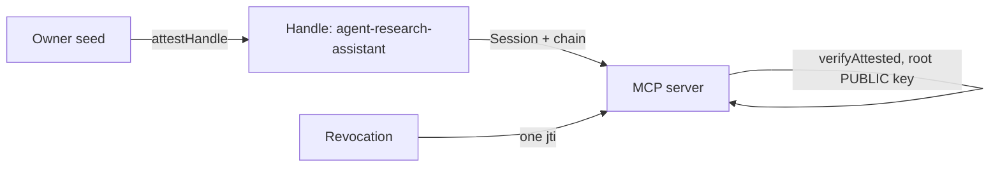

## Что можно построить

Рабочая сила автономных агентов, безопасных для выпуска из вашей
инфраструктуры: каждый агент хранит свою собственную пару ключей Ed25519 — не
ваш API-ключ — связанную подписанным родителем мандатом, который указывает,
чей это агент, что он может делать, для каких аудиторий и до какого времени.
MCP-сервер, провайдер инструментов или агент-партнёр проверяет мандат только
по публичному ключу владельца.

## Как это работает

Владелец выводит Handle для каждого агента и аттестует его. Цепочка аттестаций
несёт мандат: scopes, audiences, TTL caps — enforced at verification time, not
at issuance.



```typescript
const A = await ownerIdentity.attestHandle('agent-research-assistant', {
  audiences: ['mcp.example.com', 'tools.example.com'],
  scopes: ['search:web', 'files:read'],
  maxSessionTtl: 3600,
});
// Ship agentHandle + A.token to the agent runtime.
```

Агент сам подписывает сессии — ни один ключ владельца никогда не находится
внутри runtime агента. Для известных сервисов он выводит ключи каналов через
`deriveSharedSecret`; для офлайн-пиров публикует `PreKeyBundle`.

## Бенефиты

- **Нет общих API-ключей.** Утечка ключа агента раскрывает одного агента, а
  не владельца.
- **Отзыв одним вызовом.** `revokeAttestation(A.jti)` отключает агента
  везде — текущие и будущие сессии, каждая аудитория.
- **Мандаты не могут быть подделаны шире.** Никто — включая агента — не может
  расширить свои собственные scopes.
- **Офлайн-верификация.** Любой третья сторона проверяет цепочку по корневому
  публичному ключу; без базы данных, без сети.

## Компромиссы

- **Seed владельца — корень доверия.** Его потеря или компрометация
  компрометирует каждую аттестованного агента.
- **Хранилище отзыва должно быть доступно.** Отзыв только мгновенный для
  верификаторов, которые проверяют `jti`.
- **Alpha.** Package APIs are pre-1.0; pin versions.

## Ссылки

- Сценарий 1 в [protocol Use Cases guide](https://github.com/me2em-org/me2em-protocol/blob/main/packages/core/USE_CASES.md#scenario-1-ai-agent-delegation-uc-1)
- API reference at [core.me2em.com](https://core.me2em.com)
