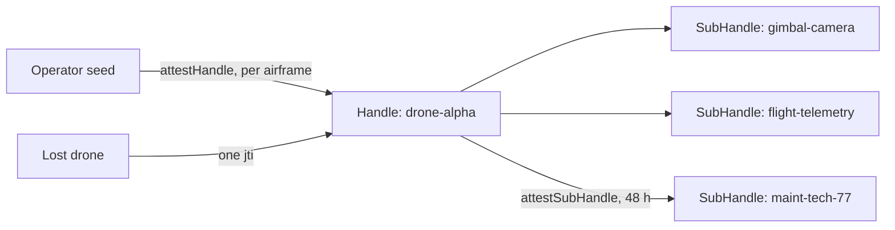

## Что можно построить

Операции флота, которые остаются криптографическими от ангара до поля:
airframes provisioned once at deploy, onboard subsystems as isolated
SubHandles, time-boxed maintenance access issued by the drone itself — and a
lost airframe removed from the entire perimeter with a single revocation.

## Как это работает

Каждый airframe — это Handle, аттестованный оператором при deploy. Сенсоры и
telemetry — derived SubHandles; окно техника — это self-issued
child attestation с 48-hour TTL — без сети.



```typescript
const B = await droneHandle.attestSubHandle('maint-tech-77', {
  audiences: ['fleet-control.internal'],
  scopes: ['maintenance:run', 'telemetry:read'],
  maxSessionTtl: 3600,
}, { ttlSeconds: 48 * 3600 });
// Hand the tech { token, chain: [A.token, B.token] }.
```

## Бенефиты

- **Нет корневого ключа в поле.** Всё ниже deploy — derived и
  attested самим airframe.
- **Изоляция подсистем.** Скомпрометированный gimbal не достигает flight
  telemetry — separate keys, separate grants.
- **Self-expiring access.** Maintenance windows die on schedule; nobody
  revokes manually.
- **Мгновенное удаление.** Потерянный или захваченный airframe отключается
  везде отзывом его аттестации `jti`.

## Компромиссы

- **Mode 1 perimeter.** Fleet control holds the root key for internal
  verification — the perimeter must be hardened.
- **Grant discipline.** SubHandle scopes bound what the airframe can attest;
  set `subNamePatterns` narrowly.
- **Alpha.** Package APIs are pre-1.0; pin versions.

## Ссылки

- Сценарий 3 в [protocol Use Cases guide](https://github.com/me2em-org/me2em-protocol/blob/main/packages/core/USE_CASES.md#scenario-3-drone-fleet-management-uc-2--iot-device-hierarchy)
- API reference at [core.me2em.com](https://core.me2em.com)
