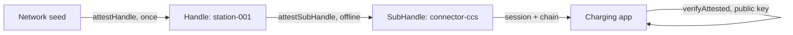

## Что можно построить

Сеть зарядки, чьи станции никогда не нуждаются в сети для работы: provisioning
once at install, connectors derived and attested on the device, sessions
signed onboard, and an independent charging app authorizing each session with
the operator's public key alone. Тот же паттерн покрывает guest token в
smart home — 24 часа, gate only, cameras outside the grant.

## Как это работает

Каждая станция — это Handle, аттестованный владельцем сети. Станция выводит
SubHandle на каждый коннектор и аттестует его локально; сессии создаются
SubHandle и проверяются приложением как external organization.



```typescript
class ChargingStation {
  async addConnector(connectorId: string, type: string) {
    const connector = await this.stationHandle.deriveSubHandle(connectorId, {
      allowedAudiences: ['ev-charging-app.com'],
      allowedScopes: ['charge:start', 'charge:stop', 'charge:status'],
      maxSessionTtl: 7200,
      displayName: `${type} Connector`,
    });
    const B = await this.stationHandle.attestSubHandle(connectorId, {
      audiences: ['ev-charging-app.com'],
      scopes: ['charge:start', 'charge:stop', 'charge:status'],
      maxSessionTtl: 7200,
    }, { ttlSeconds: 365 * 24 * 3600 });
    return { connector, B };
  }
}
```

## Бенефиты

- **Zero-connectivity operation.** Добавление коннектора занимает два local
  operations: derivation plus a self-issued attestation.
- **Contained compromise.** Взломанная станция может аттестовать только свои
  connector names, только `charge:*` scopes, только sessions under the grant —
  сеть остаётся в безопасности.
- **Independent verifiers.** Приложение зарядки никогда не держит private root
  оператора — Mode 2 verification с публичным ключом.
- **One flag per station.** Вывод из эксплуатации или подозрение станции — это
  single revocation, honourable каждым verifier.

## Компромиссы

- **Mode 1 для внутреннего telemetry только.** Собственный fleet service
  оператора держит root — harden that perimeter.
- **Grant refresh cycle.** Station attestations carry a trust window (e.g.
  one year) — plan re-attestation visits или OTA refresh.
- **Alpha.** Package APIs are pre-1.0; pin versions.

## Ссылки

- Сценарий 6 в [protocol Use Cases guide](https://github.com/me2em-org/me2em-protocol/blob/main/packages/core/USE_CASES.md#scenario-6-ev-charging-network-uc-2-iot-device-hierarchy)
- API reference at [core.me2em.com](https://core.me2em.com)
