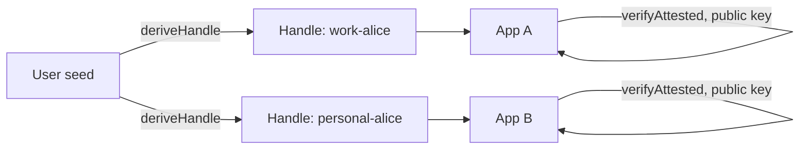

## Что можно построить

Одна идентичность, которая открывает каждое приложение в вашей экосистеме —
без базы пользователей. Аккаунт — seed-фраза: один корень, много контекстов.
Каждое приложение видит только Handle, который пользователь решает предъявить,
и проверяет сессию по корневому публичному ключу.

## Как это работает

Пользователь выводит Handle на каждый контекст — работа, личный, устройства —
и предъявляет соответствующий каждому приложению. Приложение проверяет
цепочку сессии по публичному ключу оператора.



```typescript
const workHandle = await identity.deriveHandle('work');
const session = await workHandle.createSession({
  audiences: ['app-a.internal'],
  scopes: ['profile:read', 'projects:write'],
  maxSessionTtl: 28800,
});
```

## Бенефиты

- **Нет базы пользователей.** Нет учётных данных для хранения, нет поверхности
  атаки, нет compliance burden.
- **Stateless verification.** Каждое приложение проверяет по публичному ключу
  — без session store, без token introspection.
- **Correlation-resistant.** Каждый Handle — это отдельная keypair; приложения
  не могут связать пользователя между контекстами без его согласия.
- **Одна ревокация для выхода.** `revokeAttestation(root.jti)` выходит
  пользователя из всех приложений одновременно.

## Компромиссы

- **Seed — единственная точка отказа.** Потеря фразы — потеря каждой
  идентичности. Password reset не предусмотрен по дизайну.
- **Ревокация требует хранилища.** Мгновенная ревокация доступна только
  верификаторам, которые проверяют `jti`.
- **Alpha.** Package APIs are pre-1.0; pin versions.

## Ссылки

- Сценарий 4 в [protocol Use Cases guide](https://github.com/me2em-org/me2em-protocol/blob/main/packages/core/USE_CASES.md#scenario-4-multi-app-sso-uc-4)
- [SSO без базы пользователей](/ru/blog/sso-without-user-database) — полный разбор
- API reference at [core.me2em.com](https://core.me2em.com)
