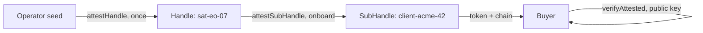

## Что можно построить

Маркетплейс для ресурсов космических аппаратов: покупатели приобретают окна
имиджинга *tasking / direct-access*, время транспондера или ёмкость нисходящего
канала — и получают подписанный, ограниченный по времени и scope чек вместо
учётных данных. Сам аппарат осуществляет продажу офлайн, между наземными
контактами.

## Как это работает

Каждый космический аппарат — это Handle, аттестованный оператором. На борту
аппарат выводит SubHandle для покупателя, аттестует его с грантом проданного
окна и создаёт сессию — токен плюс цепочка являются продуктом.



```typescript
const B = await satHandle.attestSubHandle('client-acme-42', {
  audiences: ['tasking.portal.example'],
  scopes: ['imaging:task', 'imaging:fetch'],
  maxSessionTtl: 1800,
}, { ttlSeconds: 1800 }); // the attestation dies with the window
```

## Бенефиты

- **Нет корневых ключей в сделке.** Покупатель никогда не получает закрытый
  ключ — подписанный чек *и есть* покупаемый артефакт.
- **Офлайн-расчёты.** Аппарат аттестует продажу на борту; наземные контакты
  не нужны для существования сделки.
- **Неподделываемые условия.** Приобретённые scope и длительность — это
  подписанные заявления, которые покупатель не может расширить — продление
  это новая продажа.
- **Мгновенный kill-switch.** Окно отменяется отзывом `B.jti` — например,
  аппарат переходит в safe mode.

## Компромиссы

- **Планирование продаж должно учитывать контакты.** Аттестация выпускается
  на борту: pre-provision before a pass или delivery at the next contact.
- **Seed оператора — корень доверия.** Его компрометация компрометирует
  каждый аппарат.
- **Alpha.** Package APIs are pre-1.0; pin versions.

## Ссылки

- Сценарий 2 в [protocol Use Cases guide](https://github.com/me2em-org/me2em-protocol/blob/main/packages/core/USE_CASES.md#scenario-2-satellite-capacity-marketplace-uc-2--selling-access-mode-2-flagship)
- API reference at [core.me2em.com](https://core.me2em.com)
