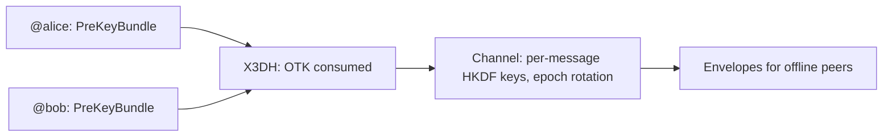

## What you can build

An end-to-end encrypted messenger on audited primitives: key agreement that
follows the Signal specification, channels where every message gets its own
key, and delivery to recipients who have not been online for days. The
account is a Handle derived from the user's seed — no registration, no
account database, same identity on every device.

## How it works

Each party publishes a PreKeyBundle; an initiator runs X3DH against it and
both sides derive the same channel. Envelopes wrap message keys for offline
recipients.



```typescript
const x3dh = await initiateX3DH(aliceIdentity, theirPreKeyBundle);
const channel = await establishChannel(x3dh.sharedSecret, 'chat-42');
const msg = await encryptChannelMessage(channel, 0, plaintext);
```

## Benefits

- **Canonical X3DH.** OTK consumption is mandatory — no zero-fallback; SPK
  signature verification defends against MITM.
- **Forward secrecy at rotation points.** Epoch rotation wipes previous
  material; per-message keys and strictly-increasing replay protection cover
  everything in between.
- **Offline delivery.** Envelopes are self-contained and replay-guarded by
  OTK consumption.
- **Seed-recoverable identity.** A second device derives the same identity
  from the seed alone — no sync service.

## Trade-offs

- **No message-level forward secrecy yet.** Double Ratchet is on the crypto
  package's roadmap; today's guarantee is at rotation points.
- **Pre-key infrastructure.** Bundles must be published and stored for
  asynchronous delivery.
- **Alpha.** Package APIs are pre-1.0; pin versions.

## References

- Scenario 9 in the [protocol Use Cases guide](https://github.com/me2em-org/me2em-protocol/blob/main/packages/core/USE_CASES.md#scenario-9-e2ee-messenger-uc-6)
- Tutorial [an E2EE messenger on Me2eM](/blog/e2ee-messenger-tutorial)
- API reference at [crypto.me2em.com](https://crypto.me2em.com)
