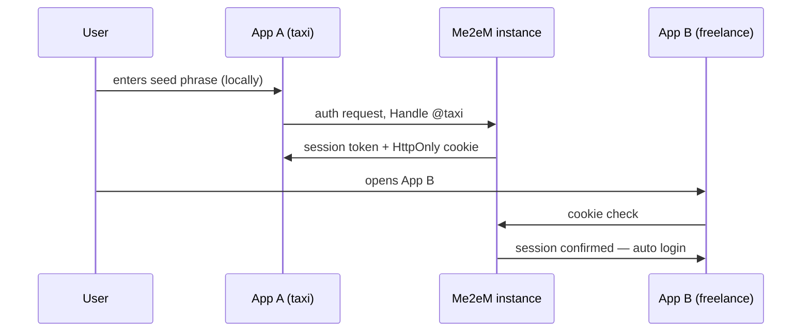

## What you can build

A fleet of applications behind one sign-in: every app in the ecosystem accepts
the same identity, the user types the seed phrase once — at the first app —
and every other app logs them in automatically. Zero registered accounts: the
instance stores no profiles, no emails, no password hashes.

## How it works

Each app receives its own Handle derived from the user's seed. The instance
issues a session per app and keeps an HttpOnly cookie for its own domain;
the next app in the ecosystem recognizes the cookie and signs the user in.

Apps inside your perimeter verify tokens statelessly with `verifyStateless`
(Mode 1); external partner apps verify attestation chains with the root
public key only (`verifyAttested`, Mode 2). Backends need no session store —
one signature check per request.

## Benefits

- **No user database.** Nothing to register, nothing to leak; the instance
  stores only hashed refresh tokens and revoked `jti` entries.
- **Instant onboarding.** A new user costs the instance nothing — derivation
  happens on the client.
- **Correlation is opt-in.** Every app sees a different Handle; taxi and
  freelance cannot link the same person unless the user reuses one Handle
  deliberately.
- **"Log out everywhere"** is a revocation entry, not a database wipe.

## Trade-offs

- **The seed is the only key back in.** Lose the phrase — lose every account
  in the ecosystem; there is no reset by design.
- **An instance must run.** SSO needs the Me2eM service (cloud or self-hosted)
  reachable at sign-in; it is infrastructure, not a static asset.
- **Same-domain requirement.** Cookie auto-login works for apps under the
  instance's domain (or subdomains); fully external apps go through Mode 2
  instead.
- **Alpha.** Package APIs are pre-1.0; pin versions.

## References

- Scenario 4 in the [protocol Use Cases guide](https://github.com/me2em-org/me2em-protocol/blob/main/packages/core/USE_CASES.md#scenario-4-multi-app-sso-uc-4--shared-user-base)
- The blog post [SSO without a user database](/ru/blog/me2em-multi-app-sso) — the full walkthrough (RU)
- API reference at [core.me2em.com](https://core.me2em.com)
