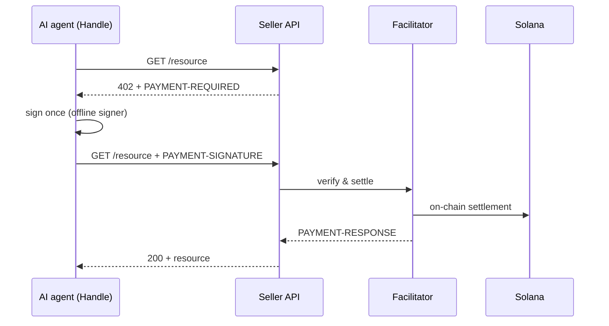

## What you can build

A paid API where the buyer is a machine: an AI agent calls your endpoint, receives an HTTP 402 with the price, signs the payment once, and retries — the facilitator settles on-chain and the response arrives. The buyer is a Handle with a bound wallet, the seller is an attested entity; neither side needs a billing account, a card, or a user database.

## How it works

The same 64-byte seed that derives the Identity also derives a deterministic Solana wallet (`m/44'/501'/{i}'/0'`, SLIP-0010). The x402 v2 wire format carries the signed artifacts over plain HTTP: `PAYMENT-REQUIRED` on the 402, `PAYMENT-SIGNATURE` on the retry, `PAYMENT-RESPONSE` on success. The buyer verifies the settlement chain-side with the seller's public root — no ledger to trust.



```typescript
import { SolanaWalletTree, SolanaX402Signer } from '@me2em/solana';
import { createPaymentFetch, readSettlement } from '@me2em/x402';

const tree = SolanaWalletTree.fromSeed(seed); // the same seed as Identity.fromSeed
const signer = new SolanaX402Signer({ wallet: tree.wallet(0) });
const pay = createPaymentFetch({ signer });

const res = await pay('https://api.example.com/resource');
// 402 → signed retry → 200; the facilitator settled on-chain
const settlement = readSettlement(res.headers);
```

## Benefits

- **One seed, two roles.** Identity and wallet derive from the same 64-byte seed — no separate wallet to provision or lose.
- **Stateless commerce.** No billing accounts, no ledgers: the buyer verifies with the seller's public root, the chain is the record.
- **Sign once, never twice.** The payment client signs exactly once per 402; replay is guarded by the reference in the transaction.
- **Chain-agnostic by contract.** `PaymentRequest` and `PaymentAdapter` are chain-agnostic; Solana ships first, other chains plug in per CAIP-2.
- **Offline signer.** The x402 signer never fetches a blockhash — it is injected, so the signing path stays deterministic and testable.

## Trade-offs

- **Solana only, for now.** Other chains need their own `PaymentAdapter`; the contracts are ready, the adapters are not.
- **SOL-only payments.** `pay` settles in SOL; stablecoin or multi-token settlement is not wired yet.
- **Release candidates.** The payment packages are pre-1.0; pin versions and expect API changes.

## References

- [Payment Layer in the protocol README](https://github.com/me2em-org/me2em-protocol/blob/main/README.md#-payment-layer)
- [@me2em/x402 package guide](https://github.com/me2em-org/me2em-protocol/blob/main/packages/x402/README.md)
- [@me2em/solana package guide](https://github.com/me2em-org/me2em-protocol/blob/main/packages/solana/README.md)
- API references at [x402.me2em.com](https://x402.me2em.com) and [solana.me2em.com](https://solana.me2em.com)
