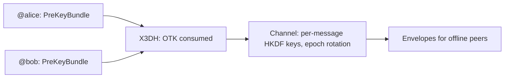

## Что можно построить

End-to-end encrypted messenger на audited primitives: key agreement, которое
следует specification Signal, channels, где каждое сообщение получает свой
key, и delivery до recipients, которые не были online днями. Account — это
Handle, выведенный из seed пользователя — без registration, без account
database, та же идентичность на каждом устройстве.

## Как это работает

Каждая сторона публикует PreKeyBundle; initiator запускает X3DH против него и
обе стороны выводят тот же channel. Envelopes wrap message keys для offline
recipients.



```typescript
const x3dh = await initiateX3DH(aliceIdentity, theirPreKeyBundle);
const channel = await establishChannel(x3dh.sharedSecret, 'chat-42');
const msg = await encryptChannelMessage(channel, 0, plaintext);
```

## Бенефиты

- **Канонический X3DH.** OTK consumption обязательна — no zero-fallback; SPK
  signature verification защищает от MITM.
- **Forward secrecy на rotation points.** Epoch rotation стирает предыдущий
  material; per-message keys и strictly-increasing replay protection покрывают
  всё между ними.
- **Offline delivery.** Envelopes self-contained и replay-guarded by
  OTK consumption.
- **Seed-recoverable identity.** Второе устройство выводит ту же идентичность
  из seed alone — без sync service.

## Компромиссы

- **Нет message-level forward secrecy пока.** Double Ratchet на roadmap crypto
  package; today's guarantee — на rotation points.
- **Pre-key infrastructure.** Bundles должны быть published и stored для
  asynchronous delivery.
- **Alpha.** Package APIs are pre-1.0; pin versions.

## Ссылки

- Сценарий 9 в [protocol Use Cases guide](https://github.com/me2em-org/me2em-protocol/blob/main/packages/core/USE_CASES.md#scenario-9-e2ee-messenger-uc-6)
- [туториал E2EE-мессенджера на Me2eM](/ru/blog/e2ee-messenger-tutorial)
- API reference at [crypto.me2em.com](https://crypto.me2em.com)
