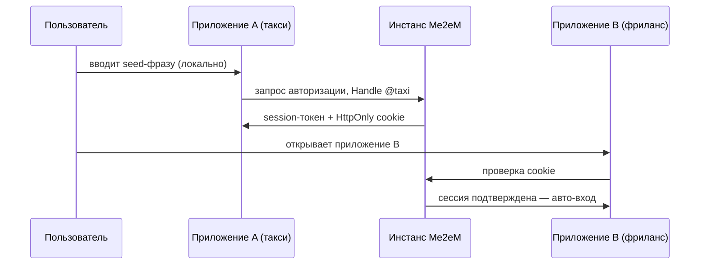

## Что можно построить

Набор приложений за одним входом: каждое приложение экосистемы принимает одну
и ту же идентичность, пользователь вводит seed-фразу один раз — в первом
приложении — и все остальные логинят его автоматически. Ноль
зарегистрированных аккаунтов: инстанс не хранит ни профилей, ни email, ни
хэшей паролей.

## Как это работает

Каждое приложение получает собственный Handle, выведенный из seed пользователя.
Инстанс выпускает сессию на приложение и держит HttpOnly-cookie своего домена;
следующее приложение экосистемы распознаёт cookie и впускает пользователя.

Приложения вашего периметра проверяют токены stateless — через
`verifyStateless` (Mode 1); внешние партнёрские приложения проверяют
аттестационные цепочки по одному лишь корневому публичному ключу
(`verifyAttested`, Mode 2). Бэкендам не нужно хранилище сессий — одна проверка
подписи на запрос.

## Бенефиты

- **Нет базы пользователей.** Нечего регистрировать, нечему утечь; инстанс
  хранит только хэшированные refresh-токены и отозванные `jti`.
- **Мгновенный онбординг.** Новый пользователь не стоит инстансу ничего —
  деривация происходит на клиенте.
- **Корреляция — по выбору пользователя.** Каждое приложение видит свой
  Handle; такси и фриланс не могут связать одного человека, пока он сам не
  использует один Handle в двух местах.
- **«Выйти со всех устройств»** — это запись о ревокации, а не очистка базы.

## Компромиссы

- **Seed — единственный ключ обратно.** Потеря фразы — потеря всех аккаунтов
  экосистемы; сброса по дизайну нет.
- **Инстанс должен работать.** SSO требует, чтобы сервис Me2eM (облачный или
  self-hosted) был доступен при входе; это инфраструктура, а не статика.
- **Требование одного домена.** Cookie-автовход работает для приложений на
  домене инстанса (или его поддоменах); полностью внешние приложения идут
  через Mode 2.
- **Alpha.** API пакетов до 1.0; фиксируйте версии.

## Ссылки

- Сценарий 4 в [руководстве Use Cases протокола](https://github.com/me2em-org/me2em-protocol/blob/main/packages/core/USE_CASES.md#scenario-4-multi-app-sso-uc-4--shared-user-base)
- Статья [SSO без базы пользователей](/ru/blog/me2em-multi-app-sso) — полный разбор
- Справочник API на [core.me2em.com](https://core.me2em.com)
