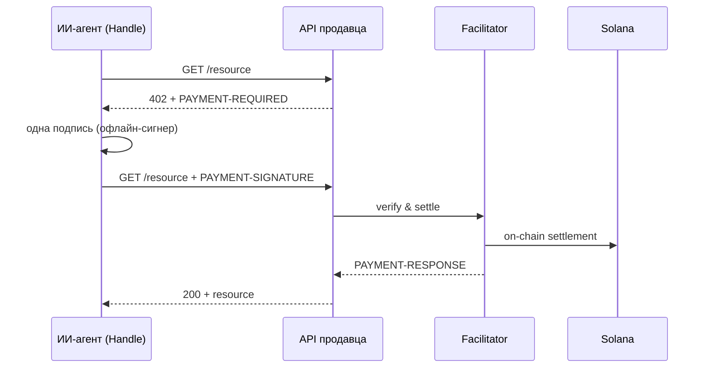

## Что можно построить

Платный API, где покупатель — машина: ИИ-агент вызывает ваш endpoint, получает HTTP 402 с ценой, подписывает платёж один раз и повторяет запрос — facilitator завершает сделку on-chain, и ответ приходит. Покупатель — Handle со связанным кошельком, продавец — аттестованная сущность; ни одной стороне не нужны платёжный аккаунт, карта или база пользователей.

## Как это работает

Тот же 64-байтный seed, из которого выводится Identity, выводит и детерминированный Solana-кошелёк (`m/44'/501'/{i}'/0'`, SLIP-0010). Проводной формат x402 v2 переносит подписанные артефакты по обычному HTTP: `PAYMENT-REQUIRED` в 402, `PAYMENT-SIGNATURE` в повторе, `PAYMENT-RESPONSE` при успехе. Покупатель проверяет settlement on-chain по публичному корню продавца — без реестра, которому нужно верить.



```typescript
import { SolanaWalletTree, SolanaX402Signer } from '@me2em/solana';
import { createPaymentFetch, readSettlement } from '@me2em/x402';

const tree = SolanaWalletTree.fromSeed(seed); // тот же seed, что у Identity.fromSeed
const signer = new SolanaX402Signer({ wallet: tree.wallet(0) });
const pay = createPaymentFetch({ signer });

const res = await pay('https://api.example.com/resource');
// 402 → подписанный повтор → 200; facilitator завершил on-chain
const settlement = readSettlement(res.headers);
```

## Преимущества

- **Один seed — две роли.** Идентичность и кошелёк выводятся из одного 64-байтного seed — отдельный кошелёк не нужно создавать или терять.
- **Stateless-коммерция.** Без платёжных аккаунтов и реестров: покупатель проверяет по публичному корню продавца, запись — в блокчейне.
- **Одна подпись, никогда дважды.** Клиент платит подписывает ровно один раз на 402; повтор защищён reference в транзакции.
- **Chain-agnostic по контракту.** `PaymentRequest` и `PaymentAdapter` не зависят от цепи; Solana поставлен первым, другие цепи подключаются по CAIP-2.
- **Офлайн-сигнер.** x402-сигнер никогда не запрашивает blockhash — он подаётся извне, путь подписи остаётся детерминированным и тестируемым.

## Компромиссы

- **Пока только Solana.** Для других цепей нужны свои `PaymentAdapter`; контракты готовы, адаптеров ещё нет.
- **Платежи только в SOL.** `pay` завершает в SOL; stablecoin или мульти-токен пока не подключены.
- **Release candidates.** Платёжные пакеты pre-1.0; фиксируйте версии и ждите изменений API.

## Ссылки

- [Payment Layer в README протокола](https://github.com/me2em-org/me2em-protocol/blob/main/README.md#-payment-layer)
- [Гид по @me2em/x402](https://github.com/me2em-org/me2em-protocol/blob/main/packages/x402/README.md)
- [Гид по @me2em/solana](https://github.com/me2em-org/me2em-protocol/blob/main/packages/solana/README.md)
- API-справки на [x402.me2em.com](https://x402.me2em.com) и [solana.me2em.com](https://solana.me2em.com)
