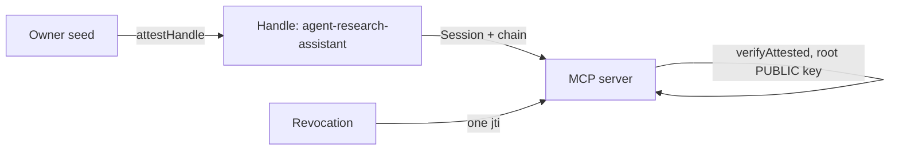

## 你可以构建什么

一支自主代理 workforce，安全地释放到你的基础设施之外：每个代理持有自己的 Ed25519 密钥对——不是你的 API 密钥——由父级签发的授权绑定，说明它是谁的代理、它能做什么、面向哪些受众、直到何时。MCP 服务器、工具提供商或代理伙伴仅用主人的公钥即可验证授权。

## 它是如何工作的

主人导出每个代理的 Handle 并证明它。证明链携带授权：scopes、audiences、TTL 限制——在验证时强制执行，不是在签发时。



```typescript
const A = await ownerIdentity.attestHandle('agent-research-assistant', {
  audiences: ['mcp.example.com', 'tools.example.com'],
  scopes: ['search:web', 'files:read'],
  maxSessionTtl: 3600,
});
// Ship agentHandle + A.token to the agent runtime.
```

代理自行签署会话——主人的密钥永远不会出现在代理的 runtime 中。对于已知服务，它通过 `deriveSharedSecret` 导出通道密钥；对于离线对等方，它发布 `PreKeyBundle`。

## 优势

- **没有共享 API 密钥。** 代理密钥泄露只暴露一个代理，而不是主人。
- **一次调用撤销。** `revokeAttestation(A.jti)` 在所有地方禁用代理——当前和未来的会话，每个受众。
- **授权无法被伪造得更宽。** 没有人——包括代理——可以扩展自己的 scopes。
- **离线验证。** 任何第三方用根公钥检查链；无需数据库，无需网络。

## 权衡

- **主人的 seed 是信任根。** 它的丢失或被入侵会破坏每个已证明的代理。
- **撤销存储必须可访问。** 撤销仅对检查 `jti` 的验证器是即时的。
- **Alpha。** 包 API 是 1.0 之前版本；固定版本。

## 链接

- 场景 1 在[协议使用场景指南](https://github.com/me2em-org/me2em-protocol/blob/main/packages/core/USE_CASES.md#scenario-1-ai-agent-delegation-uc-1)
- [core.me2em.com](https://core.me2em.com) 上的 API 参考
