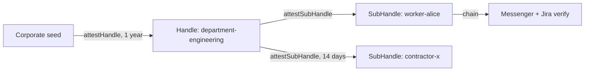

## 你可以构建什么

一个企业身份层，发放访问权限的机器从不持有 master key：HR 在部门的授权下证明员工和承包商，Messenger 和 Jira 独立验证相同的链，终止是一次在所有地方有效的撤销。

## 它是如何工作的

企业一次性证明每个部门；HR 机器在该授权下导出和证明工人。Scope 上限是继承的——即使被入侵的 HR 机器也无法创建权限高于部门的员工。



```typescript
const worker = await deptHandle.deriveSubHandle(employeeId, {
  allowedAudiences: ['corp-messenger.internal', 'jira.internal'],
  allowedScopes: scopes,
  maxSessionTtl: 28800, // one workday
});
const B = await deptHandle.attestSubHandle(employeeId, {
  audiences: ['corp-messenger.internal', 'jira.internal'],
  scopes, maxSessionTtl: 28800,
}, { ttlSeconds: 365 * 24 * 3600 });
```

## 优势

- **知识分离。** 根密钥存储在保险库中；HR 仅操作已证明的授权。
- **无升级路径。** 部门授权之外的 `channel:management` 被每个验证器拒绝——`SCOPE_EXCEEDED` 在 `ROOT` 级别。
- **一次操作离职。** `revokeAttestation(B.jti)` 杀死工人在所有连接服务中的所有当前和未来会话。
- **承包商自行过期。** 两周 TTL 不需要在结束日期进行离职操作。

## 权衡

- **部门授权是上限。** 高于它的权限需要由根直接证明的单独 handle。
- **Mode 1 无分支撤销。** 如果内部工具验证 `verifyStateless`，只有每个会话的 `jti` 可撤销——在离职重要的地方使用 Mode 2。
- **Alpha。** 包 API 是 1.0 之前版本；固定版本。

## 链接

- 场景 7 在[协议使用场景指南](https://github.com/me2em-org/me2em-protocol/blob/main/packages/core/USE_CASES.md#scenario-7-corporate-messenger-uc-3--multi-context-identity)
- 生产级 Redis [RevocationChecker](https://github.com/me2em-org/me2em-protocol/blob/main/packages/core/USE_CASES.md#%EF%B8%8F-infrastructure-production-revocationchecker-redis) 实现
