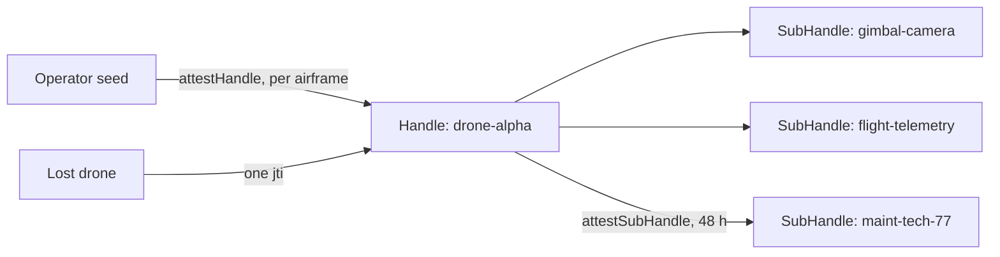

## 你可以构建什么

从机库到现场的机队操作保持加密：airframes 在部署时一次性预配， onboard 子系统作为隔离的 SubHandles，无人机本身发布限时维护访问权限——丢失的机体通过一次撤销从整个边界中移除。

## 它是如何工作的

每个 airframe 是操作者在部署时证明的 Handle。传感器和遥测是导出的 SubHandles；技术人员的窗口是带有 48 小时 TTL 的自签发子证明——无需网络。



```typescript
const B = await droneHandle.attestSubHandle('maint-tech-77', {
  audiences: ['fleet-control.internal'],
  scopes: ['maintenance:run', 'telemetry:read'],
  maxSessionTtl: 3600,
}, { ttlSeconds: 48 * 3600 });
// Hand the tech { token, chain: [A.token, B.token] }.
```

## 优势

- **现场无根密钥。** 部署以下的一切由 airframe 自身导出和证明。
- **子系统隔离。** 被入侵的云台不会到达飞行遥测——不同的密钥，不同的授权。
- **自过期访问。** 维护窗口按计划死亡；没有人手动撤销。
- **即时移除。** 丢失或被俘的机体通过撤销其证明 `jti` 在所有地方禁用。

## 权衡

- **Mode 1 边界。** 机队控制持有内部验证的根密钥——必须强化该边界。
- **授权纪律。** SubHandle scopes 限制了 airframe 可以证明的内容；将 `subNamePatterns` 设置得窄一些。
- **Alpha。** 包 API 是 1.0 之前版本；固定版本。

## 链接

- 场景 3 在[协议使用场景指南](https://github.com/me2em-org/me2em-protocol/blob/main/packages/core/USE_CASES.md#scenario-3-drone-fleet-management-uc-2--iot-device-hierarchy)
- [core.me2em.com](https://core.me2em.com) 上的 API 参考
