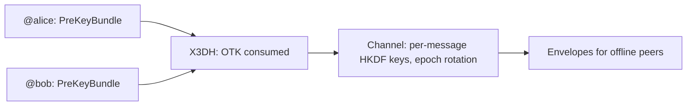

## 你可以构建什么

基于审计原语的端到端加密 messenger：密钥协商遵循 Signal 规范，通道中每条消息获得自己的密钥，以及发送给数天未在线的接收者的投递。账户是从用户种子导出的 Handle——无需注册、无需账户数据库、每个设备相同的身份。

## 它是如何工作的

每方发布 PreKeyBundle；发起方对其运行 X3DH，双方导出相同的通道。信封为离线接收者包装消息密钥。



```typescript
const x3dh = await initiateX3DH(aliceIdentity, theirPreKeyBundle);
const channel = await establishChannel(x3dh.sharedSecret, 'chat-42');
const msg = await encryptChannelMessage(channel, 0, plaintext);
```

## 优势

- **标准 X3DH。** OTK 消耗是强制性的——没有零回退；SPK 签名验证防范 MITM。
- **旋转点的正向安全。** 纪元旋转清除之前的材料；每条消息的密钥和严格递增的重放保护覆盖它们之间的所有内容。
- **离线投递。** 信封是自包含的，由 OTK 消耗进行重放保护。
- **种子可恢复身份。** 第二台设备仅从种子导出相同的身份——无需同步服务。

## 权衡

- **尚无消息级正向安全。** Double Ratchet 在加密包的路线图；今天的保证在旋转点。
- **Pre-key 基础设施。** 捆绑包必须发布和存储以进行异步投递。
- **Alpha。** 包 API 是 1.0 之前版本；固定版本。

## 链接

- 场景 9 在[协议使用场景指南](https://github.com/me2em-org/me2em-protocol/blob/main/packages/core/USE_CASES.md#scenario-9-e2ee-messenger-uc-6)
- [Me2eM 上的 E2EE Messenger 教程](/zh/blog/e2ee-messenger-tutorial)
- [crypto.me2em.com](https://crypto.me2em.com) 上的 API 参考
