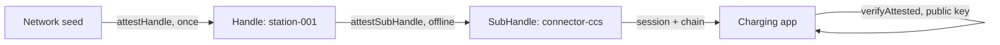

## 你可以构建什么

一个充电站网络，其充电站工作时从不需要网络：安装时一次性预配、连接器在设备上导出和证明、会话在 onboard 签署、独立的充电应用仅用操作者的公钥授权每个会话。该模式也覆盖智能家居中的访客令牌——24 小时、仅门、授权外的摄像头。

## 它是如何工作的

每个充电站是网络所有者证明的 Handle。充电站为每个连接器导出 SubHandle 并本地证明它；会话由 SubHandle 创建并由应用作为外部组织验证。



```typescript
class ChargingStation {
  async addConnector(connectorId: string, type: string) {
    const connector = await this.stationHandle.deriveSubHandle(connectorId, {
      allowedAudiences: ['ev-charging-app.com'],
      allowedScopes: ['charge:start', 'charge:stop', 'charge:status'],
      maxSessionTtl: 7200,
      displayName: `${type} Connector`,
    });
    const B = await this.stationHandle.attestSubHandle(connectorId, {
      audiences: ['ev-charging-app.com'],
      scopes: ['charge:start', 'charge:stop', 'charge:status'],
      maxSessionTtl: 7200,
    }, { ttlSeconds: 365 * 24 * 3600 });
    return { connector, B };
  }
}
```

## 优势

- **零连接操作。** 添加连接器需要两个本地操作：导出加上自签发证明。
- **受限的入侵。** 被入侵的充电站只能证明自己的连接器名称、仅 `charge:*` scopes、仅授权下的会话——网络保持安全。
- **独立验证器。** 充电应用从不持有操作者的私有根——Mode 2 验证公钥。
- **每站一个标记。** 退役或怀疑一个充电站是一次每个验证器尊重的单次撤销。

## 权衡

- **Mode 1 仅用于内部遥测。** 操作者自己的机队服务持有根——强化该边界。
- **授权刷新周期。** 充电站证明携带信任窗口（例如一年）——计划重新证明访问或 OTA 刷新。
- **Alpha。** 包 API 是 1.0 之前版本；固定版本。

## 链接

- 场景 6 在[协议使用场景指南](https://github.com/me2em-org/me2em-protocol/blob/main/packages/core/USE_CASES.md#scenario-6-ev-charging-network-uc-2--iot-device-hierarchy)
- [core.me2em.com](https://core.me2em.com) 上的 API 参考
