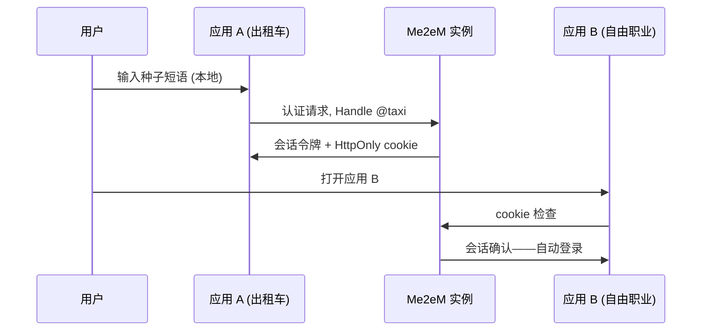

## 你可以构建什么

一个在单一登录后的应用群：生态系统的每个应用接受相同的身份，用户输入种子短语一次——在第一个应用——其他应用自动登录他们。零注册账户：实例不存储任何配置文件、电子邮件或密码哈希。

## 它是如何工作的

每个应用接收从用户种子导出的自己的 Handle。实例为每个应用发布会话并保持 HttpOnly cookie 用于其自己的域；生态系统的下一个应用识别 cookie 并登录用户。

你边界内的应用通过 `verifyStateless`（Mode 1）无状态验证令牌；外部合作伙伴应用仅用根公钥验证证明链（`verifyAttested`，Mode 2）。后端不需要会话存储——每个请求一次签名检查。

## 优势

- **没有用户数据库。** 无需注册、无需泄露；实例仅存储哈希的刷新令牌和已撤销的 `jti` 条目。
- **即时入职。** 新用户不花费实例任何东西——导出在客户端发生。
- **关联是用户选择。** 每个应用看到不同的 Handle；出租车和自由职业无法链接同一个人，除非用户故意在两个地方重用同一个 Handle。
- **"在所有设备上退出"** 是一个撤销条目，而不是数据库清除。

## 权衡

- **种子是唯一恢复密钥。** 丢失短语——丢失生态系统中的每个账户；按设计没有重置。
- **实例必须运行。** SSO 需要 Me2eM 服务（云或自托管）在登录时可达；它是基础设施，不是静态资产。
- **同域要求。** Cookie 自动登录适用于实例域（或其子域）下的应用；完全外部应用走 Mode 2。
- **Alpha。** 包 API 是 1.0 之前版本；固定版本。

## 链接

- 场景 4 在[协议使用场景指南](https://github.com/me2em-org/me2em-protocol/blob/main/packages/core/USE_CASES.md#scenario-4-multi-app-sso-uc-4--shared-user-base)
- [无用户数据库的 SSO](/zh/blog/me2em-multi-app-sso)——完整演练
- [core.me2em.com](https://core.me2em.com) 上的 API 参考
