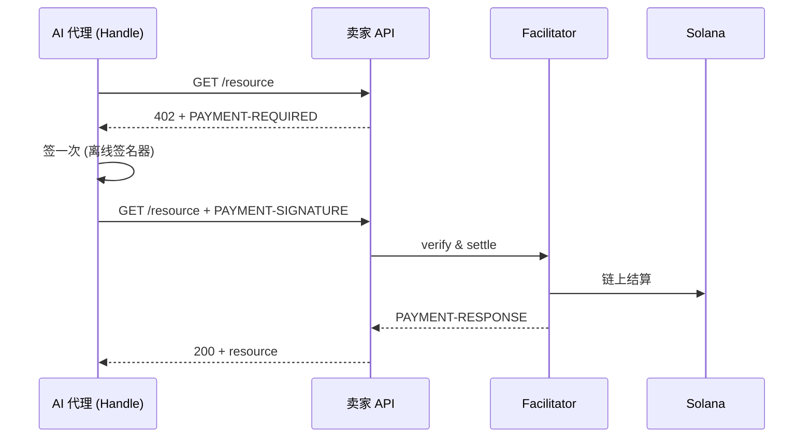

## 你可以构建什么

一个买家是机器的付费 API：AI 代理调用你的端点，收到带价格的 HTTP 402，只签一次支付并重试——facilitator 在链上完成结算，响应随之到达。买家是绑定了钱包的 Handle，卖家是经认证的实体；双方都不需要计费账户、银行卡或用户数据库。

## 它是如何工作的

派生 Identity 的同一个 64 字节 seed 也派生出确定性 Solana 钱包（`m/44'/501'/{i}'/0'`，SLIP-0010）。x402 v2 线格式通过普通 HTTP 承载已签名工件：402 中的 `PAYMENT-REQUIRED`、重试中的 `PAYMENT-SIGNATURE`、成功时的 `PAYMENT-RESPONSE`。买家用卖家的公钥根在链上验证结算——无需信任任何账本。



```typescript
import { SolanaWalletTree, SolanaX402Signer } from '@me2em/solana';
import { createPaymentFetch, readSettlement } from '@me2em/x402';

const tree = SolanaWalletTree.fromSeed(seed); // 与 Identity.fromSeed 相同的 seed
const signer = new SolanaX402Signer({ wallet: tree.wallet(0) });
const pay = createPaymentFetch({ signer });

const res = await pay('https://api.example.com/resource');
// 402 → 已签名重试 → 200；facilitator 已在链上结算
const settlement = readSettlement(res.headers);
```

## 优势

- **一个 seed，两种角色。** 身份和钱包派生自同一个 64 字节 seed——无需单独配置或丢失钱包。
- **无状态商务。** 没有计费账户、没有账本：买家用卖家的公钥根验证，链即记录。
- **只签一次，绝不付两次。** 支付客户端对每个 402 恰好签一次；交易中的 reference 防止重放。
- **按契约链无关。** `PaymentRequest` 与 `PaymentAdapter` 与链无关；Solana 先行，其他链按 CAIP-2 接入。
- **离线签名器。** x402 签名器从不获取 blockhash——它由外部注入，签名路径保持确定性且可测试。

## 权衡

- **目前仅限 Solana。** 其他链需要各自的 `PaymentAdapter`；契约已就绪，适配器尚未实现。
- **仅 SOL 支付。** `pay` 以 SOL 结算；稳定币或多代币结算尚未接入。
- **Release candidates。** 支付包为 pre-1.0；请固定版本并预期 API 变化。

## 参考

- [协议 README 中的 Payment Layer](https://github.com/me2em-org/me2em-protocol/blob/main/README.md#-payment-layer)
- [@me2em/x402 包指南](https://github.com/me2em-org/me2em-protocol/blob/main/packages/x402/README.md)
- [@me2em/solana 包指南](https://github.com/me2em-org/me2em-protocol/blob/main/packages/solana/README.md)
- API 参考：[x402.me2em.com](https://x402.me2em.com) 和 [solana.me2em.com](https://solana.me2em.com)
