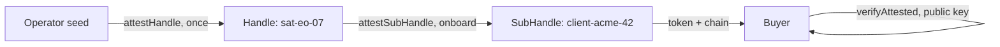

## 你可以构建什么

航天器资源的交易市场：买家购买成像 *任务调度/直接访问* 窗口、转发器时间或下行链路容量——并获得一个签名的、时间盒制、scope 盒制的收据，而不是凭证。航天器在离线状态下自行出售，在地面接触之间。

## 它是如何工作的

每个航天器是操作者证明的 Handle。在 onboard，航天器为买家导出 SubHandle、用已售窗口的授权证明它，并发布会话——令牌加链就是产品。



```typescript
const B = await satHandle.attestSubHandle('client-acme-42', {
  audiences: ['tasking.portal.example'],
  scopes: ['imaging:task', 'imaging:fetch'],
  maxSessionTtl: 1800,
}, { ttlSeconds: 1800 }); // the attestation dies with the window
```

## 优势

- **交易中无根密钥。** 买家从未收到私钥——签名收据 *就是* 可购买的工件。
- **离线结算。** 航天器在 onboard 证明销售；地面接触不需要交易存在。
- **防篡改条款。** 购买的 scope 和持续时间是签名的声明，买家无法扩展——续期是新销售。
- **即时 kill-switch。** 窗口通过撤销 `B.jti` 取消——例如，航天器进入安全模式。

## 权衡

- **销售计划必须尊重接触。** 证明在 onboard 发布：在过境前预配或在下次接触时交付。
- **操作者的种子是信任根。** 它的入侵会破坏每个航天器。
- **Alpha。** 包 API 是 1.0 之前版本；固定版本。

## 链接

- 场景 2 在[协议使用场景指南](https://github.com/me2em-org/me2em-protocol/blob/main/packages/core/USE_CASES.md#scenario-2-satellite-capacity-marketplace-uc-2--selling-access-mode-2-flagship)
- [core.me2em.com](https://core.me2em.com) 上的 API 参考
